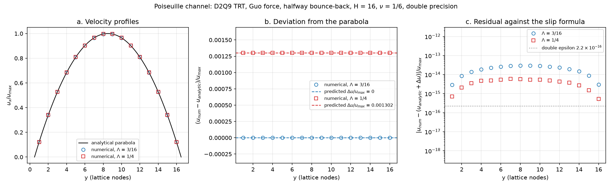

# gpu-accelerated-lbm

An open-source lattice Boltzmann CFD solver in CUDA C++17, designed as
scientific software: header-only library code shared between host and device,
a CPU reference implementation that serves as the oracle for the GPU kernels,
and tests whose tolerances are derived from floating-point error bounds.

## Status

In development. The design decisions and their rationale are recorded in
[docs/DESIGN.md](docs/DESIGN.md).

Implemented and verified:

- D2Q9 lattice
- Shifted equilibrium and moments
- TRT collision with validated parameters (runtime magic parameter $\Lambda$)
- Guo body force (Guo et al. 2002), split for TRT, with a uniform force policy
- Halfway bounce-back walls, selected through per-node flags
- Periodic domains
- Fused pull stream-collide with two buffers, on CPU and GPU, sharing one node
  function
- `<Storage, Compute>` precision split through a storage conversion trait:
  float/float, double/double, float storage with double compute, and
  experimental 16-bit storage (P16) with float compute
- Poiseuille channel validation on CPU and GPU
- Benchmark application for the GPU step

Limitations, stated plainly:

- Two-dimensional only. Equilibrium, moments, force and collision are
  lattice-generic; `Grid2D`, the node function and the kernels are 2D and need
  3D counterparts ([DESIGN.md, section 1](docs/DESIGN.md#1-scope-and-lattice)).
- P16 storage is experimental and does not reproduce the Poiseuille validation
  at float quality (see below).
- The Poiseuille tolerance is not a proven bound (see below).
- Measurements come from one machine (RTX 3050 Laptop under WSL2).

Not done yet: see the [Roadmap](#roadmap).

## Design highlights

- Lattice-generic templates for the collision-side code (D2Q9 now, D3Q19
  planned; no second lattice exists, so the genericity is by construction and
  untested): [DESIGN.md, section 1](docs/DESIGN.md#1-scope-and-lattice)
- `<Storage, Compute>` precision templates with shifted populations
  (DDF-shifting, Lehmann et al. 2022) and a conversion trait:
  [section 3](docs/DESIGN.md#3-numerical-precision)
- Structure-of-arrays layout with $x$ as the fastest index:
  [section 4](docs/DESIGN.md#4-memory-layout-soa)
- Fused pull scheme with two buffers:
  [section 5](docs/DESIGN.md#5-propagation-fused-pull-two-buffers)
- Validated 32-bit indexing (`Q*N <= INT32_MAX`):
  [section 8](docs/DESIGN.md#8-grid-indexing-and-node-types)
- One thread per node over the flattened node index:
  [section 9](docs/DESIGN.md#9-gpu-execution-and-verification)
- Collision and force as template policies:
  [section 2](docs/DESIGN.md#2-collision-operator-trt) and
  [section 11](docs/DESIGN.md#11-body-force)

### Precision configurations

| Storage / compute | Bytes per node update | Status |
|---|---|---|
| double / double | 145 | reference for validation |
| float / float | 73 | default performance configuration |
| float / double (mixed) | 73 | implemented, tested bitwise CPU-vs-GPU |
| P16 / float | 37 | experimental |

Bytes per node update is `2 * 9 * sizeof(Storage) + 1` (two buffers of nine
populations plus one flag byte). P16 is a 16-bit format with 1 sign, 4
exponent and 11 mantissa bits (the layout studied as FP16C by Lehmann et
al. 2022), range up to $2 - 2^{-10}$, rounding to nearest
(ties to even) and an invalid pattern (NaN) on overflow. It halves the
population memory (8192 x 8192 fits in 4 GB; float storage stops at
4096 x 4096) and is 1.28 to 1.29x faster than float/float on large grids when the GPU
is thermally limited (1.46x on a cool GPU), not the 1.97x of the traffic ratio,
because the integer conversion makes the kernel instruction-bound. Its main
limitation is accuracy: a force-driven flow started from rest stalls at a fixed
point of the rounded scheme short of the steady state, with an error that
scales as $c \cdot 2^{-12} \tfrac{H^2}{\nu}$ (an empirical fit over the 20 of 24 measured
cases that do not saturate, with $c$ between 0.012 and 0.033). Details: [DESIGN.md, section 3](docs/DESIGN.md#3-numerical-precision).

## Validation: Poiseuille flow

The body-force-driven channel (periodic in $x$, halfway bounce-back walls) is
the validation case for the boundary and force implementation. With TRT and
halfway bounce-back the steady solution is the analytical parabola shifted by
a uniform slip

$$
\Delta u = \frac{F_x}{2\nu} \cdot \frac{16\Lambda - 3}{12},
$$

(Ginzburg, Verhaeghe, d'Humieres 2008, Eq. (2.29) and Table 1), which vanishes
at $\Lambda = \tfrac{3}{16}$.

Measured with `apps/poiseuille` in double precision on the GPU, for
$\Lambda = \tfrac{3}{16}$ and $\Lambda = \tfrac{1}{4}$, $H = 8, 16, 32, 64$ and $\nu = 0.01, \tfrac{1}{6}, 0.5$: the
numerical profile equals the parabola plus $\Delta u$ at round-off level (residual at
most $2.7\times10^{-12} u_{\max}$, see [DESIGN.md, section 12](docs/DESIGN.md#12-validation-poiseuille-flow)
for details and caveats). $\Lambda = \tfrac{1}{12}$ is covered by the tests.

Case $H = 16$, $\nu = \tfrac{1}{6}$: the numerical profiles (a), their offset from the
parabola against the predicted slip (b), and the residual against the slip
formula (c).

What each precision is validated for:

- **Double:** all test cases ($H = 8, 16$; $\nu = \tfrac{1}{6}, \tfrac{1}{2}$;
  $\Lambda = \tfrac{3}{16}, \tfrac{1}{4}, \tfrac{1}{12}$), CPU and GPU.
- **Float:** $H = 8$ with both viscosities and $H = 16$ with
  $\nu = \tfrac{1}{2}$, CPU and GPU. At $H = 16$ with $\nu = \tfrac{1}{6}$ the derived
  float tolerance is 0.9 to 1.3 times the slip, so that pair is left out as a
  whole, and the wider and less viscous channels are not validated in float.
  Measured with the app (`--compute float`), the float error
  is below the slip in 10 of the 12 cases with $\Lambda = \tfrac{1}{4}$, but not at
  $\nu = 0.01$ with $H = 32$ and $H = 64$.
- **P16:** 12 cases per backend with weaker claims: the slip is claimed to be
  resolved only for $H = 8$, $\nu = \tfrac{1}{2}$; in the other cases the tests check
  $u_x$, $u_y$ and $\rho$ within the derived bounds without claiming to resolve
  the slip, and check that the tolerance is below the smallest reference
  velocity in the channel.
- **Float storage with double compute:** not validated on a flow. It is
  tested for the conversion, the composition of the step and bitwise
  CPU-vs-GPU equality only.

The Poiseuille tolerance rests on a stated physical assumption, the decay rate
of the slowest hydrodynamic mode of the channel, and is not a proven bound.
The mean-density part rests on a sound argument (streaming and bounce-back are
exact permutations, the collision conserves mass, the per-step errors
accumulate linearly), but it is not a fully proven bound as implemented: the
per-step mass bound is sampled every 1000 steps and assumed to bound the steps
in between (monotone approach of the velocity), and its derivation counts the
roundings of unfused arithmetic, while the GPU Poiseuille target keeps FMA
contraction. Details in
[DESIGN.md, section 12](docs/DESIGN.md#12-validation-poiseuille-flow).

The app options `--compute double|float` and `--storage same|float|p16` make
the float and P16 measurements reproducible:

    ./build/apps/lbm_poiseuille --compute float
    ./build/apps/lbm_poiseuille --compute float --storage p16

To regenerate the figure (requires the CSV files written by the default
double/double run of `lbm_poiseuille` into `output/`, see below; a float or
P16 run writes the same file names and overwrites them, so run the default
configuration last):

    python3 -m venv .venv
    .venv/bin/pip install -r scripts/requirements.txt
    .venv/bin/python scripts/plot_poiseuille.py

## Performance

`apps/benchmark` (`lbm_benchmark`) times the production launcher `lbm::step_gpu`
with CUDA events and reports MLUPS, the effective bandwidth for the minimum
traffic per node update, and the fraction of the bandwidth of a
device-to-device copy kernel measured in the same run. Methodology and
conditions: [DESIGN.md, section 13](docs/DESIGN.md#13-performance).

Results on an RTX 3050 Laptop GPU (4 GB, 192 GB/s theoretical peak, copy kernel
about 183 GB/s), WSL2, on AC power, 2048 x 2048 channel, median of 7
repetitions, GPU cool at the start:

| Storage / compute | Unforced MLUPS | % of copy | Forced MLUPS | % of copy |
|---|---|---|---|---|
| float / float | 2516 | 100.0 | 2516 | 100.0 |
| P16 / float | 3662 | 73.8 | 3292 | 66.3 |
| double / double | 354 | 27.9 | 237 | 18.7 |
| float / double | 316 | 12.6 | 219 | 8.7 |

- Float is at about 100 % of the copy-kernel bandwidth on large grids: it
  cannot go faster without moving fewer bytes.
- Double is bound by the FP64 pipe of this GPU (1/64 of the FP32 rate), not by
  memory.
- Float at 128 x 128 is limited by the launch path under WSL2 (about 8 to 9 us
  per step in the AC session; a launch cost of 9.5 to 10.4 us was measured in
  the earlier, lower-power state). 256 x 256 and 512 x 512 reach 75 to 89 % of
  the copy bandwidth.
- P16 speed-up over float/float on large grids: 1.28 to 1.29x unforced and
  1.13 to 1.14x forced with the GPU thermally limited (4096 x 4096), 1.46x and 1.31x on a cool GPU.
- Nsight Compute counters cannot be collected on this machine, so the
  bound-by statements come from instruction counts and rooflines, not from
  hardware counters.

The measurements depend on the thermal and power state of the GPU; the
conditions are given in the DESIGN section. To reproduce:

    ./build/apps/lbm_benchmark --storage all --sizes 2048 --geometry channel --reps 7 --rep-ms 500
    ./build/apps/lbm_benchmark --storage float,p16 --sizes 1024,2048,4096,8192 --reps 7 --rep-ms 500

## Verification approach

- Test tolerances are derived from floating-point error bounds and operation
  counts (shared constants with their derivations in
  `tests/support/error_bounds.hpp`), never tuned against the data. The stated
  exception is the Poiseuille tolerance, which rests on a physical estimate of
  the decay rate (see above).
- Mutation checks during development: components were deliberately broken and
  the tests were checked for failure. For example, the symmetric part of the
  Guo source term is not exercised by the Poiseuille flow (removing it leaves
  the steady profile unchanged at round-off level). It is tested
  independently by the second moment of the collision in long double
  (`ForceCollide.SecondMomentIncludesSymmetricSource`); the composition test in
  `tests/test_force.cpp` only pins the expression of the code.
- The accuracy of the forced collision in float and double is tested against
  the same library code evaluated in long double
  (`ForceTest.ForcedCollisionMatchesLongDoubleReference`). That test checks
  rounding, not the formula.
- CPU and GPU kernels are compared bitwise, including the forced collision,
  float storage with double compute, and P16 storage; the GPU comparison tests
  are compiled with `--fmad=false`.
- The exact and bitwise tests assume IEEE binary32/binary64 arithmetic without
  excess precision (checked at compile time) and without contraction of
  `a*b+c` into FMA on the host, which every test target enforces with
  `-ffp-contract=off`.
- Poiseuille validation runs on the CPU and on the GPU (the latter with
  production compiler flags, i.e. nvcc's default FMA contraction; the
  tolerance derivation is not argued separately for fused arithmetic).
- CI has three jobs: a CUDA build (all targets, warnings as errors) that runs
  the CPU tests; a CPU-only build with FMA instructions enabled
  (`-march=x86-64-v3`) that runs all tests (the 151 CPU tests); and a CPU-only Debug build with
  AddressSanitizer and UndefinedBehaviorSanitizer. GitHub-hosted runners have
  no GPU, so no kernel is executed in CI: the badge says nothing about GPU
  correctness. The GPU tests are built in CI and run locally.
- An optional workflow (`.github/workflows/gpu-sim.yml`) builds the two GPU
  test executables with CUDA 13.0 for compute_90 (PTX) and runs them on
  PantheonSim's simulated H100
  ([pantheonsim](https://github.com/pantheongpu/pantheonsim)). It runs on
  manual dispatch and on pushes and pull requests that touch the code. It
  checks behaviour, not performance, and uses a different toolchain and code
  path (CUDA 13.0, PTX for sm_90) than the local runs (CUDA 12.0, sm_86), so it
  complements the GPU runs on real hardware and does not replace them. The
  main CI badge still covers no GPU execution.

## Building and running

Tested environment: WSL2 with Ubuntu 24.04, g++ 13.3, nvcc 12.0 (Ubuntu
package), CMake 3.28, NVIDIA GeForce RTX 3050 Laptop (sm_86). The minimum CMake
version required by `CMakeLists.txt` is 3.24.

    cmake -S . -B build
    cmake --build build -j

The default CUDA architecture is 86; override it with
`-DCMAKE_CUDA_ARCHITECTURES=<arch>` at configure time.

Run all tests, or only the CPU tests (the GPU tests carry the label `gpu`):

    ctest --test-dir build --output-on-failure
    ctest --test-dir build -LE gpu --output-on-failure

Run the Poiseuille measurement (needs a GPU; run from the repository root,
since it writes CSV files to `output/`):

    ./build/apps/lbm_poiseuille

CMake options:

- `LBM_ENABLE_CUDA` (default ON): build the CUDA code. With `OFF` the CPU
  reference and the CPU tests build without nvcc; the GPU tests and the
  applications are skipped. With `ON` and no CUDA compiler, configuration
  fails.
- `LBM_BUILD_TESTS` (default ON): build the unit tests (fetches GoogleTest
  v1.18.0, pinned by SHA-256 hash)
- `LBM_BUILD_APPS` (default ON): build the applications (needs CUDA)
- `LBM_WARNINGS_AS_ERRORS` (default OFF): treat warnings as errors; enabled in
  CI. C++ code is compiled with `-Wall -Wextra -Wpedantic`; CUDA sources get
  `-Wall -Wextra` on the host pass (no `-Wpedantic`). The reason for the
  missing `-Wpedantic` there was never evaluated.

## Repository structure

- `include/lbm/`: header-only library (namespace `lbm`)
  - `lattice/`: lattice definitions (D2Q9)
  - `collision/`: TRT collision
  - `propagation/`: fused pull stream-collide node function
  - `cpu/`: CPU reference step
  - `cuda/`: CUDA step kernel, device buffer, error checking
  - `boundary/`: empty placeholder (halfway bounce-back is inside the node
    function)
  - `grid.hpp`, `equilibrium.hpp`, `moments.hpp`, `force.hpp`, `storage.hpp`,
    `config.hpp`: grid and node types, equilibrium, moments, body force,
    storage conversion and the P16 format, portability macros
- `tests/`: GoogleTest unit tests; `tests/gpu/` holds the GPU tests;
  `tests/support/` holds the shared error bounds, fields and reference code;
  `poiseuille_common.hpp` is the code shared by the CPU and GPU Poiseuille
  tests; `device_compile_check.cu` is a compile-only check of the device code
- `apps/poiseuille/`: Poiseuille measurement application
- `apps/benchmark/`: GPU step benchmark
- `scripts/`: plotting script for the validation figure
- `docs/`: design decisions (`DESIGN.md`) and figures (`images/`)
- `.github/workflows/`: CI workflow
- `src/cpu/`, `src/cuda/`, `validation/`: empty placeholders

## Roadmap

- Moving walls and the lid-driven cavity (Ghia et al.)
- Open boundaries (velocity and pressure) and flow past a cylinder at
  $\mathrm{Re} = 100$
- D3Q19, with 3D counterparts of the grid, the node function and the kernels
- Single-buffer propagation (AA pattern, Bailey et al. 2009, or esoteric pull): halves the
  population memory; no speed-up is expected on this GPU
- CUDA graphs (or a multi-step kernel) for launch-bound grids
- A hardware binary16 conversion for P16, to cut its instruction count (this
  means the binary16 layout, which was the less accurate of the two formats
  compared)
- Dropping the $c = 0$ terms in the generic loops, to reduce the FP64
  instruction count
- Bounded CPU-vs-GPU comparison with FMA enabled

## References

- I. Ginzburg, F. Verhaeghe, D. d'Humieres, "Two-relaxation-time lattice
  Boltzmann scheme: about parametrization, velocity, pressure and mixed
  boundary conditions", Commun. Comput. Phys. 3 (2008).
- M. Lehmann et al., "Accuracy and performance of the lattice Boltzmann method
  with 64-bit, 32-bit, and customized 16-bit number formats", Phys. Rev. E 106,
  015308 (2022).
- P. Bailey et al., "Accelerating lattice Boltzmann fluid flow simulations
  using graphics processors", ICPP (2009).
- U. Ghia, K. N. Ghia, C. T. Shin, "High-Re solutions for incompressible flow
  using the Navier-Stokes equations and a multigrid method", J. Comput. Phys.
  48 (1982).
- Z. Guo, C. Zheng, B. Shi, "Discrete lattice effects on the forcing term in
  the lattice Boltzmann method", Phys. Rev. E 65, 046308 (2002).

## License

MIT, see [LICENSE](LICENSE).
