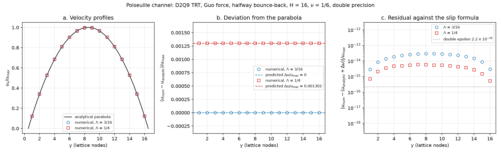

# gpu-accelerated-lbm

An open-source lattice Boltzmann CFD solver in CUDA C++17, designed as
scientific software: header-only library code shared between host and device,
a CPU reference implementation that serves as the oracle for the GPU kernels,
and tests whose tolerances are derived from floating-point error bounds.

## Status

In development. The design decisions and their rationale are recorded in
[docs/DESIGN.md](docs/DESIGN.md).

Implemented and verified:

- D2Q9 lattice
- Shifted equilibrium and moments
- TRT collision with validated parameters (runtime magic parameter $\Lambda$)
- Guo body force, split for TRT, with a uniform force policy
- Halfway bounce-back walls, selected through per-node flags
- Periodic domains
- Fused pull stream-collide with two buffers, on CPU and GPU, sharing one node
  function
- Poiseuille channel validation on CPU and GPU

Not done yet: see the [Roadmap](#roadmap).

## Design highlights

- Lattice-generic templates (D2Q9 now, D3Q19 planned):
  [DESIGN.md, section 1](docs/DESIGN.md#1-scope-and-lattice)
- `<Storage, Compute>` precision templates with DDF-shifting:
  [section 3](docs/DESIGN.md#3-numerical-precision)
- Structure-of-arrays layout with $x$ as the fastest index:
  [section 4](docs/DESIGN.md#4-memory-layout-soa)
- Fused pull scheme with two buffers:
  [section 5](docs/DESIGN.md#5-propagation-fused-pull-two-buffers)
- Validated 32-bit indexing (`Q*N <= INT32_MAX`):
  [section 8](docs/DESIGN.md#8-grid-indexing-and-node-types)
- Collision and force as template policies:
  [section 2](docs/DESIGN.md#2-collision-operator-trt) and
  [section 11](docs/DESIGN.md#11-body-force)

## Validation: Poiseuille flow

The body-force-driven channel (periodic in $x$, halfway bounce-back walls) is
the validation case for the boundary and force implementation. With TRT and
halfway bounce-back the steady solution is the analytical parabola shifted by
a uniform slip

$$
\Delta u = \frac{F_x}{2\nu}\,\frac{16\Lambda - 3}{12},
$$

(Ginzburg, Verhaeghe, d'Humieres 2008, Eq. (2.29) and Table 1), which vanishes
at $\Lambda = 3/16$.

Measured with `apps/poiseuille` in double precision on the GPU, for
$\Lambda = 3/16$ and $\Lambda = 1/4$, $H = 8, 16, 32, 64$ and $\nu = 0.01, 1/6, 0.5$: the
numerical profile equals the parabola plus $\Delta u$ at round-off level (residual at
most $2.7\times10^{-12}\,u_{\max}$, see [DESIGN.md, section 12](docs/DESIGN.md#12-validation-poiseuille-flow)
for details and caveats). $\Lambda = 1/12$ is covered by the tests.

*Case $H = 16$, $\nu = 1/6$: the numerical profiles (a), their offset from the
parabola against the predicted slip (b), and the residual against the slip
formula (c).*

To regenerate the figure (requires the CSV files written by `lbm_poiseuille`
into `output/`, see below):

    python3 -m venv .venv
    .venv/bin/pip install -r scripts/requirements.txt
    .venv/bin/python scripts/plot_poiseuille.py

## Verification approach

- Test tolerances are derived from floating-point error bounds and operation
  counts, never tuned against the data.
- Mutation checks during development: components were deliberately broken and
  the tests were checked for failure. For example, the symmetric part of the
  Guo source term is not exercised by the Poiseuille flow (removing it leaves
  the steady profile unchanged at round-off level), so it is covered by the
  composition test in `tests/test_force.cpp`.
- CPU and GPU kernels are compared bitwise; the GPU comparison tests are
  compiled with `--fmad=false`.
- Poiseuille validation runs on the CPU and on the GPU (the latter with
  production compiler flags).
- CI builds everything, including the CUDA code, with warnings as errors and
  runs the CPU tests. GitHub-hosted runners have no GPU, so the GPU tests are
  built but run locally.

## Building and running

Tested environment: WSL2 with Ubuntu 24.04, g++ 13.3, nvcc 12.0 (Ubuntu
package), CMake 3.28, NVIDIA GeForce RTX 3050 Laptop (sm_86). The minimum CMake
version required by `CMakeLists.txt` is 3.24.

    cmake -S . -B build
    cmake --build build -j

The default CUDA architecture is 86; override it with
`-DCMAKE_CUDA_ARCHITECTURES=<arch>` at configure time.

Run all tests, or only the CPU tests (the GPU tests carry the label `gpu`):

    ctest --test-dir build --output-on-failure
    ctest --test-dir build -LE gpu --output-on-failure

Run the Poiseuille measurement (needs a GPU; run from the repository root,
since it writes CSV files to `output/`):

    ./build/apps/lbm_poiseuille

CMake options:

- `LBM_BUILD_TESTS` (default ON): build the unit tests (fetches GoogleTest
  v1.18.0)
- `LBM_BUILD_APPS` (default ON): build the applications
- `LBM_WARNINGS_AS_ERRORS` (default OFF): treat warnings as errors; enabled in
  CI

## Repository structure

- `include/lbm/`: header-only library (namespace `lbm`)
  - `lattice/`: lattice definitions (D2Q9)
  - `collision/`: TRT collision
  - `propagation/`: fused pull stream-collide node function
  - `cpu/`: CPU reference step
  - `cuda/`: CUDA step kernel, device buffer, error checking
  - `grid.hpp`, `equilibrium.hpp`, `moments.hpp`, `force.hpp`, `config.hpp`:
    grid and node types, equilibrium, moments, body force, portability macros
- `tests/`: GoogleTest unit tests; `tests/gpu/` holds the GPU tests;
  `device_compile_check.cu` is a compile-only check of the device code
- `apps/poiseuille/`: Poiseuille measurement application
- `scripts/`: plotting script for the validation figure
- `docs/`: design decisions (`DESIGN.md`) and figures (`images/`)
- `.github/workflows/`: CI workflow

## Roadmap

- Moving walls and the lid-driven cavity (Ghia et al.)
- Velocity and pressure boundaries and flow past a cylinder at $\mathrm{Re} = 100$
- D3Q19
- Performance measurement and optimization
- FP16 storage
- Bounded CPU-vs-GPU comparison with FMA enabled

## References

- I. Ginzburg, F. Verhaeghe, D. d'Humieres, "Two-relaxation-time lattice
  Boltzmann scheme: about parametrization, velocity, pressure and mixed
  boundary conditions", Commun. Comput. Phys. 3 (2008).
- M. Lehmann et al., "Accuracy and performance of the lattice Boltzmann method
  with 64-bit, 32-bit, and customized 16-bit number formats", Phys. Rev. E 106,
  015308 (2022).
- P. Bailey et al., "Accelerating lattice Boltzmann fluid flow simulations
  using graphics processors", ICPP (2009).
- U. Ghia, K. N. Ghia, C. T. Shin, "High-Re solutions for incompressible flow
  using the Navier-Stokes equations and a multigrid method", J. Comput. Phys.
  48 (1982).
- Z. Guo, C. Zheng, B. Shi, "Discrete lattice effects on the forcing term in
  the lattice Boltzmann method", Phys. Rev. E 65, 046308 (2002).

## License

MIT, see [LICENSE](LICENSE).
